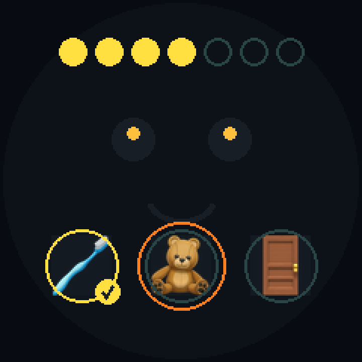

# 景阳的加油机 · jingyang-gogogo

> 一台 ESP32 桌面小机器，陪一个 5 岁半的孩子养成习惯、鼓励他提问、顺手认几个字。
> 不是早教机，也不是智能音箱——**它只做一件事：让孩子每天有三次"被看见"的时刻。**

我儿子叫景阳，5 岁半，上幼儿园。他有两个问题：
早上磨蹭着不出门，晚上不肯刷牙；还有就是——**出门看到什么都问"为什么"**。

于是有了这个项目。它没有用任何大模型做"儿童陪聊"，相反：

- **AI 不即兴对孩子说话**（只播放被审核过的固定语料）
- **爸妈的话由设备送达**（认可必须是真人的声音）
- **习惯是仪式，不是考核**（没有红叉、没有失败画面、不发积分）

设备上长这样（每个习惯一个 emoji 图标，不识字也认得出）：



认字卡和问题卡（服务器渲染中文，设备零字库）：


---

## 三条设计原则

| 原则 | 落地 |
|---|---|
| **有性格的教练** | 角色「小豆豆」会眨眼、会开心、会**示弱**（"你教教我嘛"）。所有台词是预录音频，不依赖云端 TTS |
| **看得见的进度** | 屏幕顶部 7 个格子（本周完成情况），底部每个习惯一颗星；5 岁半看不懂"连续 5 天"，但看得懂格子填满 |
| **爸妈的认可** | 家长在手机点一句 → 设备播 SD 卡里那条录音。**AI 只是搬运工，权威留给爸妈** |

反依赖也是硬指标：每天建议互动 ≤20 分钟，角色会"困了要睡觉"，不承接无限聊天。

---

## 主线：自驱力

```
                    自驱力
              （孩子自己开始，而不是被推着走）
                          │
        ┌─────────────────┴─────────────────┐
        │                                   │
   习惯（每天做到）                    好奇心（想问就问）
   这是载体                            这是显现
        │                                   │
        └─────────────────┬─────────────────┘
                          │
                 ┌────────┴────────┐
                 │ 识字 / 作业 / 学习 / 成绩 │
                 │ 这些是【衍生物】，不是目标 │
                 └─────────────────┘
```

**这条主线只有一个问题：「这件事，是他自己要做的，还是被推着做的？」**

习惯和好奇心不是两个并列的功能，而是同一条主线的**载体**和**显现**。
识字、作业、学习、成绩，是主线强化之后**自然长出来的东西**——
一旦把它们当成目标去追，家长就得靠催、靠奖、靠罚去推动，
孩子就从"我想做"变成"为了不被说而做"，主线当场退化。

### 衍生物规则（比功能清单更重要）

| # | 规则 |
|---|---|
| 1 | **衍生物不能成为设备的独立目标**——不设识字量目标、不做作业提醒、不记分数 |
| 2 | **衍生物只能"伴随"发生**——由主线的动作自然带出（刷完牙 → 出现"牙"） |
| 3 | **衍生物不能有考核、货币、排名**——不考试、不发积分、不横向比较 |
| 4 | **需要靠压力才能运转的功能，一律不做** |

> 一条硬边界：**这个设备永远不做作业提醒。**
> 作业是学校和家庭的领域，设备一旦介入，它就从"陪伴"变成"监工"。
> 同理——不做学习计划、不做成绩记录、不做"今日学习任务"。

### 新功能准入六问（加功能前先过一遍）

| # | 问题 | 不合格的信号 |
|---|---|---|
| 1 | 它服务"每天做到"或"想问就问"吗？ | 只是"挺酷的" |
| 2 | 不是的话，它是不是某个主线的**副产品**？ | 需要专门的动作/仪式 |
| 3 | 会让**孩子每天碰设备**超过 3 次吗？ | 超过就砍 |
| 4 | 需要**家长额外花时间**吗？ | 合并不进已有动作就砍 |
| 5 | 新增一种**进度货币**吗？ | 能并进星星就别单开 |
| 6 | **它需要靠压力（催/奖/罚/排名）才能运转吗？** | 需要 → 它在削弱主线 |

**过不了第 1、2、6 关的，坚决不加。**

### 一条具体的落地：每天只有一个"惊喜"

一天只推一个内容，按主线优先级挑：

```
1. 有答案还没告诉他的问题   ← 好奇心（主线）
2. 该复习的识字卡到期       ← 识字（衍生物）
3. 都没有 → 今天不给        ← 安静也是一种设计
```

新学的字不占这个名额——它发生在**习惯完成那一刻**（情境学习），属于仪式的一部分。

## 它是怎么跑的

```
 家长手机（同一个 Wi-Fi）
 http://192.168.x.x:8099
 ┌──────────────────────┐
 │ 今天的惊喜（一天一个）   │
 │ 今天要做的            │      ┌────────────────────────┐
 │ 给他一句话            │─────▶│  server.py（电脑，零依赖） │
 │ 成长档案 /album       │      │  SQLite: 打卡/问答/字卡   │
 └──────────────────────┘      └───────────┬────────────┘
                                           │ GET /api/state.txt（每 15 秒）
                               ┌───────────┴────────────┐
                               │  ESP32-S3 + GC9A01 圆屏  │
                               │  表情 / 星星 / 7 格       │
                               │  DFPlayer → 预录语音      │
                               │  问题卡 / 识字卡（图片）    │
                               └────────────────────────┘
```

**中文怎么上屏**：设备端没有中文字库（Arduino_GFX 只带 ASCII）。
所以卡片由服务器用 PIL + 苹方渲染成 240×240，转成 RGB565 发给设备，
设备只做一次 `memcpy` 到 canvas —— **设备端零字库、零排版**。

---

## 目录结构

```
.
├── server.py              # 家长端服务（标准库 + Flask 都不用，纯 http.server）
├── card.py                # 卡片渲染：问题卡 / 识字卡 → 240×240 RGB565
├── firmware/habit_coach/  # 设备端固件（ESP32-S3，~890 行）
├── hardware-test/         # 分步验收：点屏 / 语音 / 网络 / 按键，各一个最小程序
├── voice-pack/            # 120 条预录语音 + 生成脚本（macOS say + ffmpeg）
├── docs/                  # 设计文档、评审、手册、硬件清单
└── tools/                 # 演示数据 / 一键清空
```

---

## 快速开始

```bash
# 1. 起家长端（只需要 Python 3.9+）
pip install -r requirements.txt
python3 server.py            # 打开 http://127.0.0.1:8099

# 2. 看演示数据（可选）
python3 tools/demo_seed.py
./tools/reset.sh             # 正式用之前清空

# 3. 设备端：先跑分步验收，再烧完整固件
#    见 docs/hardware-bringup.md
```

语音包重新生成（换音色/改台词）：

```bash
cd voice-pack && ./make_voice.sh      # 需要 macOS 的 say + ffmpeg
```

---

## 文档

| 文档 | 内容 |
|---|---|
| [docs/manual.md](docs/manual.md) | **操作手册**：接线、烧录、家长页、台词表、各模块细节、排错 |
| [docs/hardware-bringup.md](docs/hardware-bringup.md) | 硬件清单 + 分步验收（一次只测一种硬件） |
| [docs/habit-system.md](docs/habit-system.md) | 习惯养成的科学依据：66 天、过程性表扬、为什么不做奖励机制 |
| [docs/product-review.md](docs/product-review.md) | 一次认真的自我评审：模块叠加的问题、该砍什么、优先级 |
| [docs/competitor-skylight-buddy.md](docs/competitor-skylight-buddy.md) | 竞品分析：Skylight Buddy（$120+$39/年）做对了什么、我们该学什么 |
| [docs/child-perspective.md](docs/child-perspective.md) | 从孩子视角写的一天——他到底感受到了什么 |

---

## 做到哪了

- ✅ 习惯：1–4 件、流程化（一条流程一颗星，语音按分钟分步引导）、倒计时防随手按、离线队列
- ✅ 问题罐：户外记下问题 → AI 起草 → **家长审核** → 设备播报 + 卡片
- ✅ 识字：30 字包、习惯完成自动推字卡、间隔重复（1/3/7/15 天）、不考试
- ✅ 成长档案：字卡墙 + 问题册 + 许多个「第一次」，可打印装订
- ⚠️ 固件尚未在真机上编译验证（硬件还在路上）

---

## License

代码 MIT。`voice-pack/` 里的音频是用 macOS `say` 本地生成的，仅作个人使用；
建议换成自己录的声音（见手册第七节），效果差别非常大。
